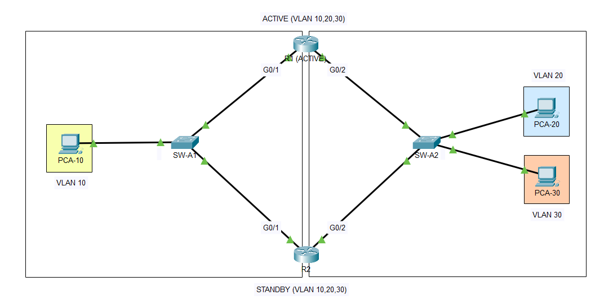

# Packet-Tracer-Project-6---FHRP-HSRP-



## Requirement

**Company:** Larkspur Logistics, a regional distribution company.

Larkspur Logistics is opening a new branch office with three departments. The branch uses two routers and two access switches. During the planning meeting, the operations manager raised one concern:

> "In our last office, one router failure cut off the whole floor, and nobody could reach the other departments until IT showed up. We can't have that here."

The network engineer (you) is asked to build a branch network where **a single router or router-link failure does not interrupt communication between departments**.

---
### Business Requirements

| # | Requirement |
|---|---|
| B1 | Three departments must be isolated into their own VLANs. |
| B2 | Departments must be able to communicate with each other (inter-VLAN routing). |
| B3 | A single router or router-link failure must not interrupt inter-VLAN communication. |
| B4 | Failover must be automatic, with no manual intervention. |
| B5 | Hosts must not need reconfiguration when a failover happens. |

### Technical Requirements

| # | Requirement |
|---|---|
| T1 | Use router-on-a-stick (802.1Q subinterfaces) on both routers for inter-VLAN routing. |
| T2 | Use HSRP version 2 with a single virtual gateway per VLAN. |
| T3 | R1 must be the **Active** router and R2 the **Standby** router for all VLANs. |
| T4 | Enable `preempt` on all HSRP groups in both routers so R1 reclaims the Active role after recovery, and in case R1 lowers its priority upon detecting a failure on a specific interface, R2 assumes Active role. |
| T5 | Use interface tracking so R1 gives up the Active role when it loses a path that R2 still has. |
| T6 | Both access switches must be dual-homed, with one trunk to each router. |
| T7 | Trunks must use native VLAN 72 and allow only VLANs 10, 20, 30, and 72. |
| T8 | Hosts must use the HSRP virtual IP as their default gateway. |

### Constraint (Packet Tracer Limitation)

Note that Packet Tracer does not support a configurable tracking `decrement`. It always uses the default of **10**. The priority gap between the two routers therefore has to be **smaller than 10**, or one failed tracked interface will never push the Active router below the Standby router. This lab uses **155 (R1)** and **150 (R2)**.

---

| Link | From | To |
|---|---|---|
| 1 | R1 g0/1 | SW-A1 g0/1 |
| 2 | R1 g0/2 | SW-A2 g0/1 |
| 3 | R2 g0/1 | SW-A1 g0/2 |
| 4 | R2 g0/2 | SW-A2 g0/2 |
| 5 | SW-A1 f0/1 | PCA-10 (VLAN 10) |
| 6 | SW-A2 f0/1 | PCA-20 (VLAN 20) |
| 7 | SW-A2 f0/2 | PCA-30 (VLAN 30) |

### Addressing Plan

| VLAN | Network | Virtual Gateway (HSRP) | R1 (Active) | R2 (Standby) |
|---|---|---|---|---|
| 10 | 192.168.10.0/24 | 192.168.10.254 | 192.168.10.252 | 192.168.10.253 |
| 20 | 192.168.20.0/24 | 192.168.20.254 | 192.168.20.252 | 192.168.20.253 |
| 30 | 192.168.30.0/24 | 192.168.30.254 | 192.168.30.252 | 192.168.30.253 |
| 72 | N/A | N/A | N/A | N/A |

### HSRP Design

| Setting | R1 | R2 |
|---|---|---|
| Version | 2 | 2 |
| Priority (all groups) | 155 | 150 |
| Preempt | Enabled | Enabled |
| Group 10 tracks | g0/2.20, g0/2.30 | g0/2.20, g0/2.30 |
| Group 20 tracks | g0/1.10 | g0/1.10 |
| Group 30 tracks | g0/1.10 | g0/1.10 |

> Each router's subinterfaces are split across two switches. If R1 loses the link to one switch, it can still be Active on the other side, so hosts on that side would send traffic to a router that cannot reach the rest of the network. Tracking makes R1 lower its priority (155 to 145) when it loses the *other* side, so R2 (150) preempts and takes over all VLANs.

---

### Acceptance Tests

| # | Test | Expected Result |
|---|---|---|
| 1 | Run `show standby brief` on R1 and R2 (all links up) | R1 is Active (155) and R2 is Standby (150) for groups 10, 20, 30. |
| 2 | Ping between PCA-10, PCA-20, and PCA-30 | All pings succeed. |
| 3 | Remove the R1 to SW-A1 link | R1's priority drops to 145 on groups 20 and 30. R2 becomes Active for all groups. |
| 4 | Ping between all PCs again | All pings succeed through R2. |
| 5 | Restore the link | R1 preempts and returns to Active (155). |
| 6 | Repeat steps 3 to 5 with the R1 to SW-A2 link | R1's priority drops to 135 on group 10 (two tracked interfaces lost). R2 becomes Active, and pings succeed. |

---

### Verification Commands

```
show standby brief
show standby

show ip interface brief
show running-config

show interfaces trunk
show vlan brief

show mac address-table
show arp

arp -a
ping <virtual IP>
```

 Command | Device | What It Does | When to Use It |
|---|---|---|---|
| `show standby brief` | R1, R2 | One line per group: interface, group, priority, preempt flag, state, Active/Standby peer, virtual IP | First check, always. Answers "who is Active, and is it who I expect?" |
| `show standby [interface]` | R1, R2 | Full detail: state, virtual IP and MAC, timers, preempt, priority vs. configured, tracked objects and their state, last state change | When `brief` looks wrong and you need the reason, such as a priority that didn't drop |
| `show ip interface brief` | R1, R2 | Up/down status of interfaces and subinterfaces | Early in any problem. A subinterface that is down or has no IP won't leave Init |
| `show running-config` | R1, R2 | Full configuration | Comparing the two routers' `standby` lines side by side |
| `show interfaces trunk` | SW-A1, SW-A2 | Trunk ports, native VLAN, allowed and forwarding VLANs | Routers look healthy but hosts can't reach the gateway |
| `show vlan brief` | SW-A1, SW-A2 | VLANs and their access ports | Host is in the wrong VLAN, or the VLAN doesn't exist |
| `show mac address-table` | SW-A1, SW-A2 | MAC-to-port table | Confirming the virtual MAC is learned on the port toward the Active router |
| `show arp` / `arp -a` | Router / PC | IP-to-MAC mappings | Checking the PC resolved the virtual IP to the virtual MAC |
| `ping <virtual IP>` | PC | Tests reachability of the gateway | After any change, from a host |

---

### Known Limitations

- Each access switch is a single point of failure for the hosts attached to it. HSRP protects the gateway, not the switch.
- The switches are not interconnected, so there is no Layer 2 loop and no STP dependency in this design.
- On real IOS, the tracking `decrement` can be set manually, and `preempt delay` is recommended. These are not available or reliable in Packet Tracer.

---

### Files

| File | Description |
|---|---|
| `P6 - FHRP (HSRP).pkt` | Packet Tracer project file |
| `P6 - FHRP (HSRP).txt` | Switch configurations (SW-A1, SW-A2) |
| `P6 - Router_Configuration.txt` | Router configurations (R1, R2) |
